# Financial-Market-Theories

*Field notes on market ideas, each with the code, the data, and what came of it.*

This repository is a working notebook, not a signal service. Each theory covers four things:

1. **What is the claim?** One sentence that can be wrong.
2. **Why could it work?** The mechanism, not the narrative.
3. **How was it tested?** The data, the sample, and the setup.
4. **What happened?** The result, including when the answer is “no edge.”

Each theory below follows the same layout: a banner, a numbered section, a folder path, then `Claim`, `Mechanism`, `Test`, and `Verdict`. The evidence section is labelled `Result` or `Observation` depending on how it was gathered. Optional `Next` and `Field note` sections follow where they help. To skim, read `Claim` and `Verdict`.

**Verdicts:** 🟢 works in practice · 🟠 context only · 🔴 no edge.

---

## Index

1. **[Surebet capacity](#01)** 
    *An edge exists on prediction markets with no delta exposure, but it is not sizeable.*
2. **[Price momentum vs OI momentum](#02)** 
    *When price moves with open interest, is the move crowded and squeeze-prone, unlike a move without new leverage?*
3. **[Liquidation levels](#03)** 
    *Do pivot levels with rising open interest become stop-loss and liquidation magnets?*
4. **[YouTube thumbnails](#04)** 
    *Is the visual mood of crypto YouTube thumbnails a usable retail-sentiment proxy?*
5. **[Bloomberg from crypto](#05)** 
    *Can the fast, sensitive memecoin market deliver news faster than Bloomberg?*
6. **[FedWatch repricing](#06)** 
    *When CME rate probabilities reprice, do rate-sensitive assets follow, or is the move already priced?*
7. **[Listing first hour](#07)** 
    *Does a newly listed coin fall in its first hour, and can that move be shorted once futures open?*
8. **[Leaderboard positioning](#08)** 
    *When top traders are crowded on one side, is the marginal buyer or seller exhausted?*
9. **[Open interest heatmap](#09)** 
    *Do price ranges with high open interest act as support and resistance?*
10. **[Order-book walls](#10)** 
    *Are large visible orders barriers, magnets, or fee-driven displays?*
11. **[Abnormal trades](#11)** 
    *Do unusually large trades against the majority identify informed or forced flow?*
12. **[Supply events](#12)** 
    *Do token unlocks and airdrops create predictable selling pressure?*
13. **[Hour-of-day and weekday performance](#13)** 
    *Are some hours or weekdays better for placing a trade after costs?*
14. **[Big trade and whale detection](#14)** 
    *Does high volume with low open interest reveal a large, better-informed player entering?*
15. **[Launch filters](#15)** 
    *Can simple early-activity filters select tokens that multiply after fees and selection bias?*
16. **[Attention index](#16)** 
    *Do news volume, search trends, TikTok attention, and crypto product sales lead retail flow?*
17. **[Indicator crowding](#17)** 
    *Can indicator scores measure crowding rather than timing?*
18. **[Weather mood](#18)** 
    *Does the weather during the trading session change mood and same-day market behaviour?*

---

## 01

**Folder:** [`theories/01-surebet-capacity/`](theories/01-surebet-capacity/)

### Claim

When the same binary event trades on two venues, buying complementary outcomes can cost less than $1. The edge is real but capacity-constrained by the shallower book.

### Mechanism

Venue fragmentation and different liquidity profiles. Polymarket may have the deeper book; the second venue may have a stale or shallow price. The arbitrage is delta-neutral in outcome, but not risk-free: platform, settlement, and resolution-rule risk remain.

### Test

Walk both order books, not just top-of-book. For size `q`, compute executable cost of YES on venue A plus NO on venue B. Count the trade only when cost < $1. Use incremental ask levels; convert Futuur's stake-by-size quote into marginal levels so cumulative depth is not counted twice. Fees are a CLI parameter (`--fee-bps`) because they are venue- and account-specific. Settlement delay, capital lockup, and withdrawal costs are not modeled.

### Result

The committed replay in `results/sample/capacity_output.json` shows:

| Size (shares) | Total cost at max size | ROI |
|---:|---:|---:|
| 1–8 | $7.44 | 7.53% |
| 9–38 | $35.72 | 6.38% |
| 39–71 | $67.45 | 5.26% |

There is no profitable range above 71 shares in the sample: the next Futuur slice lifts the average price enough to erase the edge. The interesting number is the capacity cutoff, not the peak ROI.

A separate single live trade is recorded in `results/sample/executed_trade.json`: **$28.69 on YES + $56.31 on NO = $85.00**, paying **$106.25** and returning **$21.25 (25.0%)**.

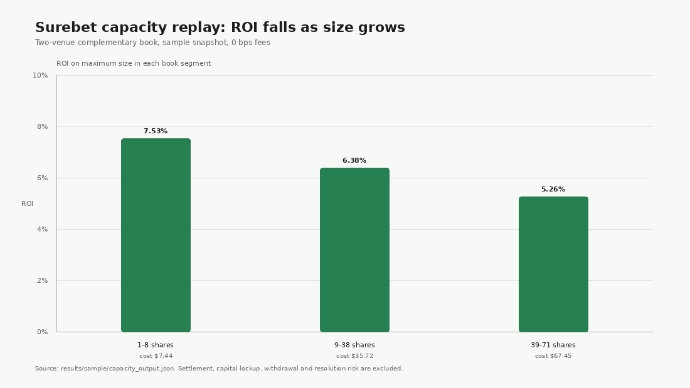

*Generated by `python3 scripts/render_result_charts.py` from `results/sample/capacity_output.json`. Fees set to 0; settlement and lockup excluded.*

### Field note

Matching the same event across venues is the hard part. Titles usually differ, and a small wording change can alter the resolution, so exact-string matching is not enough. Automating it without an LLM means hand-built rules plus manual review; a semantic model helps with matching but adds cost and its own error mode. Sizing is limited on the other side too: Polymarket usually has far more liquidity than the second venue, so the shallow book sets capacity long before the signal does.

<a href="theories/01-surebet-capacity/results/polymarket-positions.png">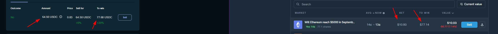</a>

*Full Polymarket screenshot: a sell panel on the left and an open position on the right.*

### Verdict

🟢 The edge is capacity-constrained. The sample's gross edge dies around 71 shares / ~$67 total cost. The live trade confirms a larger dislocation existed at least once.

### Next

Add a fee/slippage sensitivity table. A 2025 Futuur/Polymarket title-similarity scan is kept as a compact sample in `data/sample/market_similarity_sample.json`; the full output is gitignored under `data/raw/`.

---

## 02

**Folder:** [`theories/02-open-interest-momentum/`](theories/02-open-interest-momentum/)

### Claim

When price moves up or down and open interest grows much faster, the move is leveraged and crowded, and vulnerable to a squeeze in that direction. When price moves without OI, the move is more likely spot-driven and less crowded.

### Mechanism

A move attracts leveraged positions on that side. When OI grows faster than price, the move is increasingly funded by leverage rather than spot demand; funding and liquidation levels build, and the position becomes squeeze-prone. When price moves without OI, the move is more likely spot-driven and less crowded.

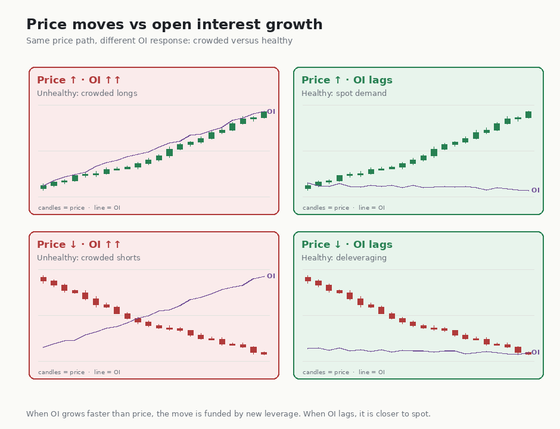

### Test

Rebuild the aggregate OI series in base-currency units, label each bar by the sign of the price return and of ΔOI, and compare forward returns across the four quadrants. Control for volatility, add fees and funding, and split in-sample versus out-of-sample.

### Observation

In live use the four-quadrant read has worked well. Five raw Pine v5 scripts from the `healthy_moves` lineage cover the view: two panel/overlay variants, an OI-coloured candle view, the most complete oscillator, and the first draft. Funding is displayed only indirectly, long/short is inferred rather than observed, and the aggregate mixes feed units. The CVD section has an exchange-index bug.

### Verdict

🟢 A reliable discretionary workflow tool. The four-quadrant read holds up in live use.

---

## 03

**Folder:** [`theories/03-liquidation-levels/`](theories/03-liquidation-levels/)

### Claim

Liquidation levels can be drawn from pivot indicators. The last pivot increases in colour opacity each time new orders enter the move, and most people are likely to place stop losses at that last pivot because of human psychology, making it a liquidation magnet.

### Mechanism

Traders anchor stops to the most recent pivot because that is a visible level where the prior move turned. When new OI enters at that pivot, the cluster of stops and liquidations grows, which can make the level a magnet rather than a barrier.

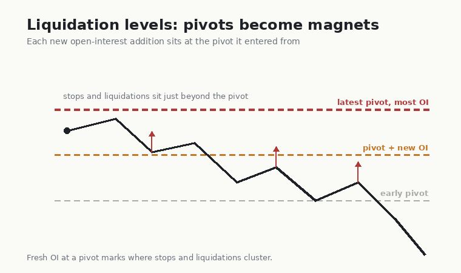

### Test

Record each large OI addition and the pivot level it references, extract the top levels per week, and measure touch, rejection, and penetration rates. Compare with funding, leverage, and actual liquidation data where available.

### Observation

In live use the pivot-level read has worked well and adds precision to the price/OI framework in 02. The source is one Pine v5 script, “OI Increase Pivot Levels”. It draws a pivot line when ΔOI is large and scales opacity with the size of the OI increase; the level is the pivot where the OI increase occurred.

### Verdict

🟢 Works well next to 02, and the pivot levels add precision to entries.

---

## 04

**Folder:** [`theories/04-youtube-thumbnails/`](theories/04-youtube-thumbnails/)

### Claim

The visual mood of top crypto YouTube thumbnails is a retail-sentiment proxy. A wall of red thumbnails may reflect fear; a wall of green may reflect euphoria. View-weighted thumbnail size is a second, weaker attention proxy.

### Mechanism

Thumbnails are the first filter in a crowded feed. Creators compete for clicks with faces, colours, and large text, so the aggregate look of a day's uploads reflects what the audience is expected to respond to. If that visual mood tracks fear or euphoria, it may lead or lag price and flow; view-weighted size measures how much attention each upload actually received.

### Test

Build a daily grid from a fixed panel of channels, extract dominant colours and face presence, and test whether thumbnail sentiment leads or lags returns and flows. The panel must exclude French-language and very small channels so it reflects the English-language crypto audience.

### Observation

The idea is novel and was worth trying, but it found no clear correlation between thumbnail mood and forward returns. The panel is real: the current run is a fresh **3-month window (2026-08-04 → 2026-11-04)** with **1,070 public videos across 24 channels**. `scripts/fetch-window.py` resolves exact upload dates and view counts with a request delay; `scripts/render-grid.py` renders the cached window offline in calendar, timeline, or per-day column layouts.

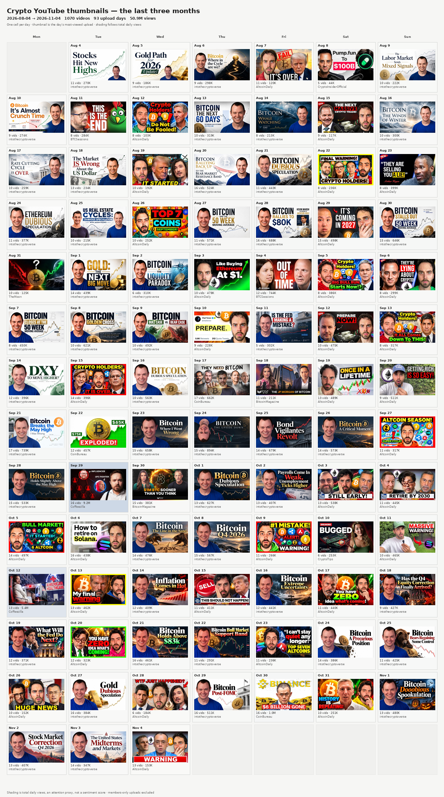

*Generated by `python3 theories/04-youtube-thumbnails/scripts/render-grid.py --start 2026-08-04 --end 2026-11-04 --layout calendar`. One cell per day; the thumbnail is the day's most-viewed upload; shading follows total daily views.*

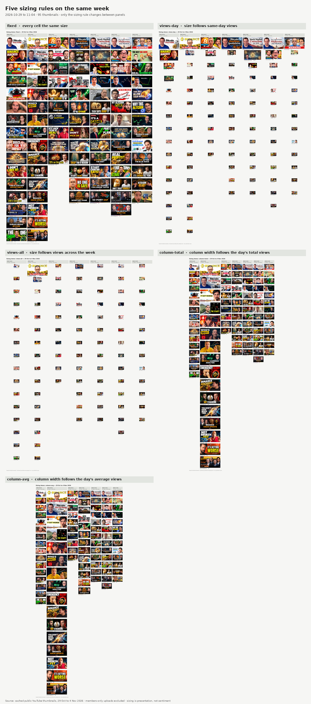

*Generated by `python3 theories/04-youtube-thumbnails/scripts/make-demo-sheet.py --suffix 2026-10-29_11-04`. The same 95 thumbnails under five cell-sizing rules: fixed, views-day, views-all, column-total, and column-avg. Sizing is presentation, not sentiment. The column rules make a busy day visually dominate; the fixed rule keeps every upload equally visible.*

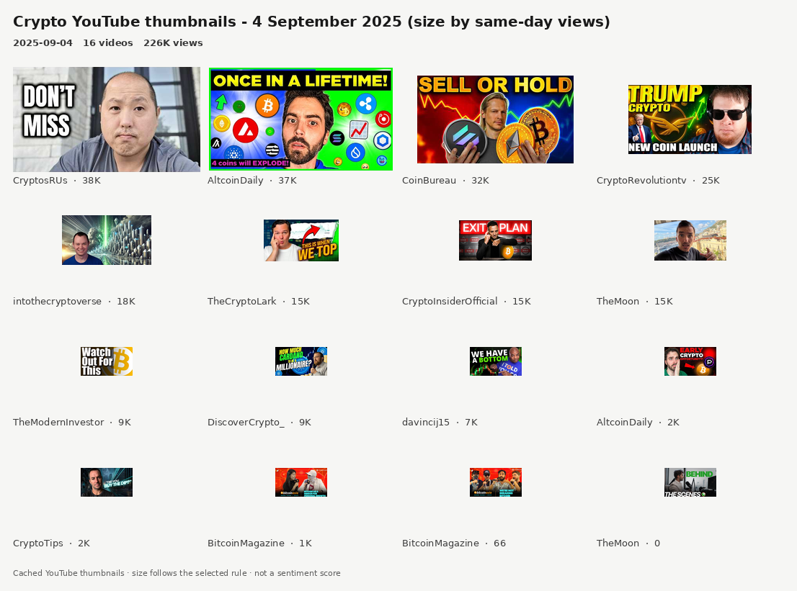

*Generated by `python3 theories/04-youtube-thumbnails/scripts/render-grid.py --date 2025-09-04 --layout columns --sizing views-day`. Sixteen uploads from the fixed channel panel; cell size follows same-day views. This is the readable unit for a manual colour and face count.*

The full per-channel timeline and the other sizing demos are in [`theories/04-youtube-thumbnails/results/`](theories/04-youtube-thumbnails/results/).

### Verdict

🔴 A worthwhile experiment: the panel and renders exist, but the correlation does not. The images remain a reusable dataset.

---

## 05

**Folder:** [`theories/05-bloomberg-from-crypto/`](theories/05-bloomberg-from-crypto/)

### Claim

A real news event does not move one launch; it produces a cluster of independent launches sharing keywords within a short window. The cluster is a better relevance filter than any single token's metadata.

### Mechanism

Launch markets are a high-frequency sensor of narrative attention. Copycat launches are noisy individually, but corroboration across unrelated deployers is informative. The signal is the cluster; the trade is a separate question.

### Test

Cluster tokens by shared keywords or links within 20 minutes. Require at least N distinct tokens and K shared keywords. Manually label 30–50 clusters as relevant or irrelevant. Compare forward returns at 1h, 6h, and 24h against matched non-cluster launches, controlling for liquidity, age, and market cap.

### Observation

The published sample is a small, synthetic demo, not the original live capture. It contains three launch narratives (`aurora`, `nova`, `orbit`) with 6, 4, and 3 timestamps respectively, plus one singleton. It shows the clustering rule and the report format. `scripts/cluster-report.js` recomputes the clusters offline and writes `results/cluster_report.json`.

### Field note

A live log from the Venezuela episode shows two clocks. Articles about the helicopter appeared at 07:44 Paris time. The first cluster detection came at 07:55, 11 minutes later, from 7 mentions inside a 20-minute window. The actionable 20-mention alert still arrived at 10:40, after Donald Trump had already confirmed the extraction at 10:21. The sensor saw the story early; the alert rule was 19 minutes behind public confirmation.

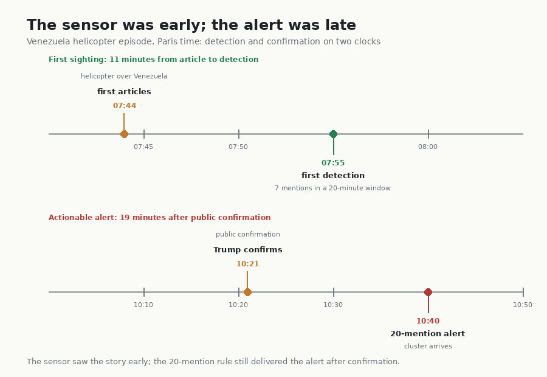

### Verdict

🟠 The cluster filter improves relevance, but the published sample is a synthetic demo rather than a labelled forward-return test. In the live episode the sensor detected the story in 11 minutes, yet the 20-mention alert still landed after public confirmation, so timeliness depends on the alert rule. Relevance and after-cost return remain open.

---

## 06

**Folder:** [`theories/06-fedwatch-repricing/`](theories/06-fedwatch-repricing/)

### Claim

Changes in the market-implied policy path lead rate-sensitive assets, and forecast repricing contains information beyond Fed-speak sentiment.

### Mechanism

FedWatch probabilities are derived from fed funds futures, so a change in the implied path is a market price updating, not an external signal. It can still lead other assets if rate markets are the fastest venue for processing new macro information; the question is whether FX, equities, and crypto adjust later.

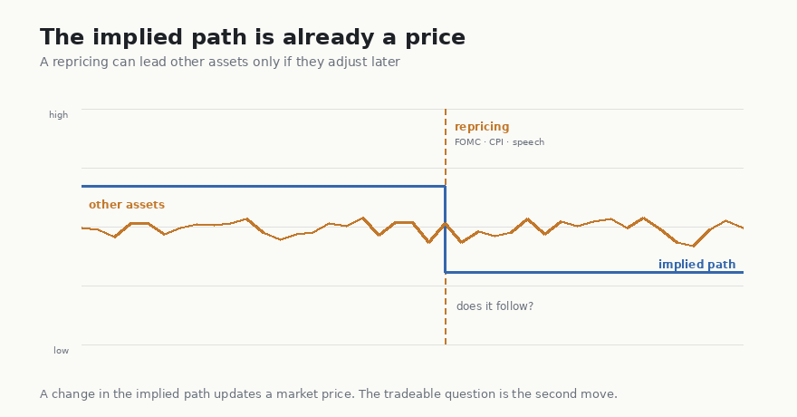

### Test

Daily FedWatch snapshots and asset prices; event windows from one hour before to five days after; controls for macro releases; placebo tests on non-event days and speeches with no repricing; transaction costs.

A naive test of “Δ probability predicts returns” is partly circular because the probability is already a market price. The non-circular versions are:

1. **Cross-asset lead-lag:** rates futures reprice first; do FX, equities, and crypto follow?
2. **Overreaction:** after a large repricing move, does the move partially reverse?
3. **Horse race:** does forecast repricing beat LLM-scored hawkishness from Fed speeches?
4. **Conditional effect:** is the signal concentrated around FOMC meetings, blackout exits, CPI, and NFP?

### Observation

Worth trying, but the attempt found no clear correlation between FedWatch repricing and the rate-sensitive assets tested. `scripts/fed-watch.js` locates the current QuikStrike view, parses the meeting block and target-rate probabilities, and **returns them as JSON**. After reviewing CME's terms, run it with `FEDWATCH_ACK_TERMS=1 FEDWATCH_USER_AGENT='you@example.com' bun scripts/fed-watch.js`.

### Compliance

The collector reads public FedWatch pages; it is not a licensed CME feed. Before running it, review CME's terms of use and `robots.txt`. Keep requests sequential and slow, identify the client, and do not bypass a login, paywall, or bot control. The scraper enforces this in practice: it refuses to run without `FEDWATCH_ACK_TERMS=1`, sends the contact set in `FEDWATCH_USER_AGENT`, and waits `FEDWATCH_DELAY_MS` (default 2000 ms) between requests. Do not commit or redistribute raw CME data; keep only derived metrics or a small timestamped snapshot, with raw captures gitignored. If CME's terms do not allow the access, use CME DataMine or another licensed source, or reconstruct the implied path from public fed funds futures.

### Verdict

🔴 The collector answers “what the curve implies now”; as a lead-lag signal it showed no edge.

---

## 07

**Folder:** [`theories/07-listing-events/`](theories/07-listing-events/)

### Claim

A newly listed coin often falls in its first hour because early holders sell into the new liquidity. Once a perpetual futures market is available, that move can be shorted; before the futures listing, it cannot.

### Mechanism

Early holders and airdrop recipients have a low cost basis and sell into the first liquid market. Before a perpetual exists, there is no easy way to short that flow; after it, the trade becomes expressible. The spot listing and the futures listing are therefore two different events.

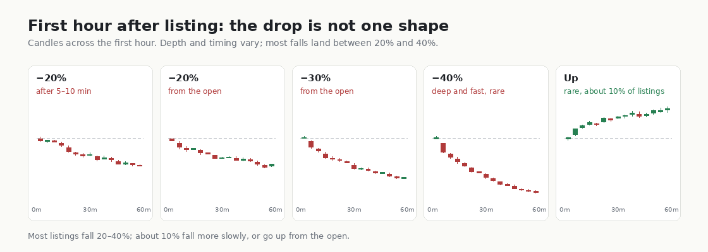

### Test

Event study around the first spot listing and the first perpetual listing. Measure the first-hour return, volume, and the availability of a short instrument. Separate the spot listing from the futures listing, and include borrow, funding, and exchange rules.

### Observation

In live use the first-hour drop appears often enough to be real, but it is inconsistent. The bearish move can start at the open or only after five to ten minutes, and the drop usually lands between 20% and 40%. In roughly 10% of cases it is slower, or the coin goes up from the open instead. Shorting also has less upside than the long side, especially on low-cap coins, so the payoff is asymmetric. The classifier in `scripts/legacy/listing-events.js` parses listing events and has a self-test.

### Verdict

🟠 The pattern exists but is not reliably tradable as a short. The hard part is filtering the coins that fall from the ones that do not, with borrow, funding, and capped upside included.

---

## 08

**Folder:** [`theories/08-leaderboard-positioning/`](theories/08-leaderboard-positioning/)

### Claim

When top traders on a venue are crowded on one side, the marginal buyer or seller is exhausted, and the crowd is vulnerable to a squeeze.

### Mechanism

Crowded one-sided positioning leaves little room for the next buyer or seller to push the price further. Funding and liquidation levels then transmit that imbalance: the crowded side pays to hold, and a move against it can force exits that accelerate the move.

### Test

Track a fixed panel of top Binance traders and Hyperliquid top-10 positioning. Normalize position size by account equity. Measure the relationship between crowding, funding, and forward returns. Separate skill from survivorship bias: leaderboards select winners after the fact.

### Observation

Leaderboard average leverage is useful as a confirmation input, not as a standalone signal. The published script ships a **synthetic example panel** (`EXAMPLE_UID_001` … `EXAMPLE_UID_005`), not real trader identifiers. Live runs load a private, gitignored `data/private/traders.json` or `TRADERS_FILE`. It aggregates long/short leverage and writes `results/leaderboard_snapshot.json` plus a BTC/ETH history.

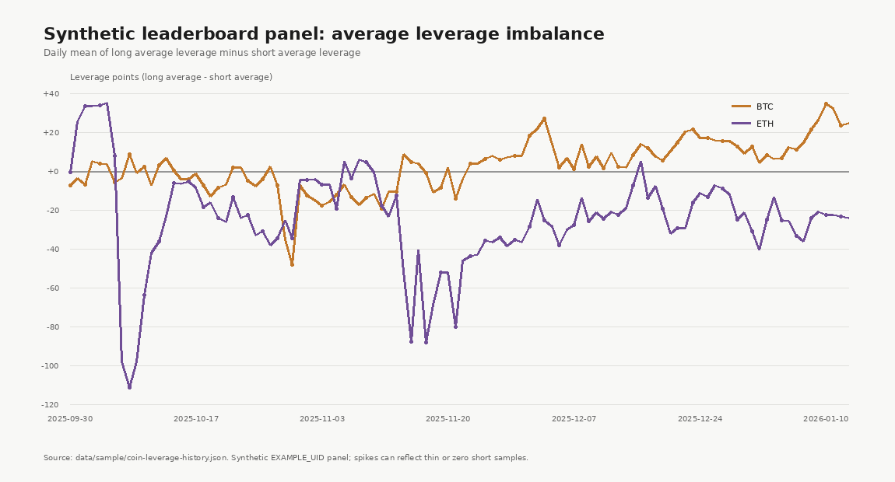

*Generated by `python3 scripts/render_result_charts.py` from `data/sample/coin-leverage-history.json`. Synthetic `EXAMPLE_UID` panel only; no real trader identifiers are published. Spikes can reflect thin or zero short samples.*

No raw pre-anonymization panel is committed, so there is nothing to blur in the public repository.

### Verdict

🟢 A good confirmation input: the average-leverage read is informative and worth keeping alongside the main setup.

---

## 09

**Folder:** [`theories/09-open-interest-levels/`](theories/09-open-interest-levels/)

### Claim

Open interest by price range shows where a lot of trades were opened and where participants are interested in trading. Those high-interest ranges are often used as support or resistance.

### Mechanism

Traders remember where they entered. Binned OI marks price ranges where positions were opened, so a retest of those ranges can trigger reactions from traders defending or adding to existing positions. That is why high-interest ranges may act as support or resistance.

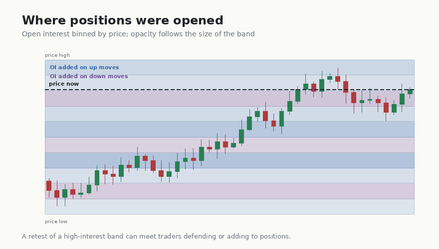

### Test

Build a price-binned OI histogram, extract the top N high-interest ranges per week, and measure touches, rejections, and penetrations against random and volume-profile ranges. Split by period and symbol.

### Observation

The open-interest-by-price view works, but it is not a favourite in the current workflow. One raw Pine v5 script colours each bar's range by OI level and ΔOI sign.

### Verdict

🟠 Useful to look at, but not part of the working set.

---

## 10

**Folder:** [`theories/10-orderbook-walls/`](theories/10-orderbook-walls/)

### Claim

Venues earn fees on volume, so displayed size and execution priority can be shaped by fee tiers, rebates, and the venue's interest in attracting large flow. A large visible wall is therefore not neutral information: it may be a magnet, a barrier, or a fee-generating display.

### Mechanism

A wall can change behaviour without ever trading. Traders may treat it as support or resistance, place stops behind it, or wait for it to disappear. At the same time, the venue and the poster may benefit from the display itself through fee tiers, rebates, or queue priority.

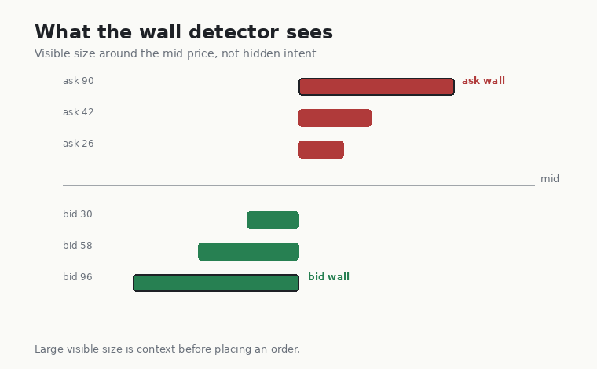

### Test

Historical L2 data around large walls. Measure price impact, time-to-touch, fill probability, and whether the wall is cancelled before execution. Include queue position and latency. The current code is a quick prototype.

### Observation

Useful context before placing an order: the wall detector shows where large visible size sits, and that is the use case. The source is a curses-based order-book simulator plus a live Binance poller. It detects large visible levels and places simulated take-profit orders. The committed snapshot is one L2 observation.

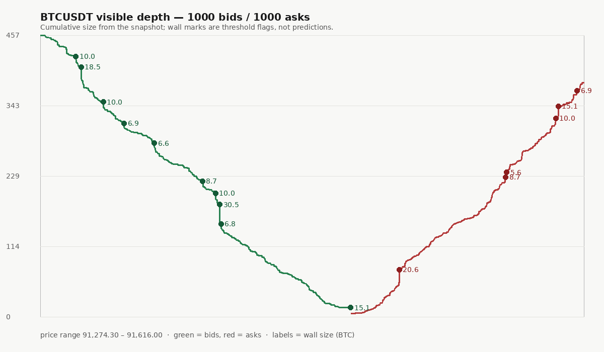

*Generated by `python3 theories/10-orderbook-walls/scripts/wall_report.py` from `data/sample/orderbook.json`. One snapshot; flags are not forecasts.*

### Verdict

🟠 Good as a pre-trade context tool; that is all it is used for.

---

## 11

**Folder:** [`theories/11-whale-concentration/`](theories/11-whale-concentration/)

### Claim

Unusually large trades that go against the majority can identify informed, forced, or contrarian flow around a prediction-market resolution.

### Mechanism

A large trade on the minority side is expensive and conspicuous. If the trader is informed, the trade should precede the resolution; if the trader is forced or contrarian, it may not. The screen is a way to find candidates, not proof of information.

### Test

Track Polymarket trades; flag large notionals on the minority side (price below 0.5), with positive PnL and a recent timestamp. Compare flagged trades with matched non-flagged trades and with forward resolution outcomes.

### Observation

A fun project with no clear result. `scripts/polymarket-insider.js` filters recent trades where `price < 0.5`, `size > 2,000`, `user_profit_loss > 0`, and the trade is inside the last 24 hours. A price below 0.5 means the trade is on the underdog side, which is the “opposite of the majority” screen. The output drops wallet identity fields.

### Field note

One alert from the Polymarket feed: **$2.2k on “Maduro out in 2025?” at 1.46% YES**, with **$148k to win**. It is a striking alert, but a single trade does not make the screen repeatable. The feed shows the position, not whether the trader was informed, lucky, or early on public reporting.

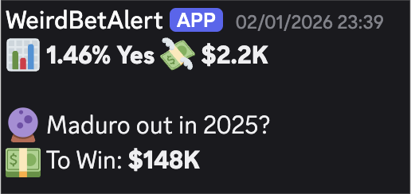

*The alert behind the field note: $2.2k YES at 1.46%, with $148k to win.*

### Verdict

🔴 A fun project with no clear edge.

---

## 12

**Folder:** [`theories/12-supply-events/`](theories/12-supply-events/)

### Claim

Token unlocks and airdrops create predictable supply pressure when the recipient base is likely to sell.

### Mechanism

Unlocks add circulating supply; recipients with a low cost basis are more likely to sell. Airdrops create recipients with no sunk cost, which makes selling psychologically easier. The size of the pressure depends on who receives the tokens and when they become transferable, not just on the headline date.

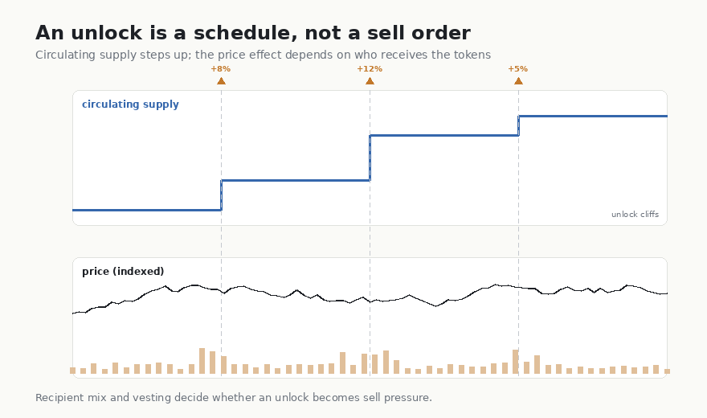

### Test

Unlock calendar, recipient composition, vesting schedule, and pre-event positioning. Measure abnormal returns and volume around the unlock, not just the headline date.

### Observation

A good idea, but nothing clear came out of it. The screen is kept as a portfolio alert. `scripts/legacy/supply-events.js` normalizes supply-event records and has a working `--self-test`.

### Verdict

🟠 Keep it as an alert, not a signal.

---

## 13

**Folder:** [`theories/13-hour-weekday-performance/`](theories/13-hour-weekday-performance/)

### Claim

The probability of an up move, and the average size of the move, are not uniform across the trading day or the week. Some hours and weekdays are better than others for placing a trade.

### Mechanism

Market participation and liquidity vary by session. Scheduled macro releases cluster at certain hours, and weekday flows differ as different regions come online. Those differences can change both the probability of an up move and the size of the move.

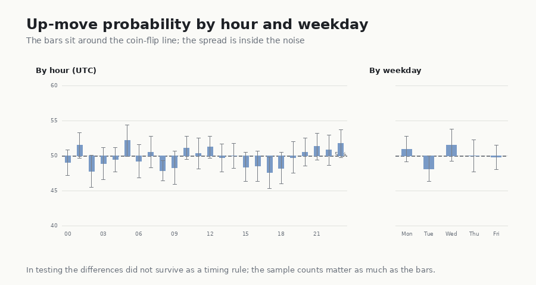

### Test

Bucket signed candle bodies by hour of day and by weekday, then report the probability of an up move, the mean and median return, and the sample count. The first pass must aggregate one sample per hour or day, not one per chart bar, and the result must survive costs.

### Observation

The probabilities looked random in testing, with no correlation to forward returns. Two raw Pine v5 scripts were imported from the indicator archive. They bucket mean signed price differences by hour and weekday and print them as percentages.

### Verdict

🔴 Not useful as a timing rule; the probabilities look random.

---

## 14

**Folder:** [`theories/14-big-trade-whale/`](theories/14-big-trade-whale/)

### Claim

When open interest is small but volume is high, it should mean a large player is entering. Large players often have better data and can move the market before the crowd.

### Mechanism

Small OI means few outstanding positions; high volume against that base implies a large player is entering and can move price before the crowd. The ratio is a candidate footprint, not direct evidence of who traded or why.

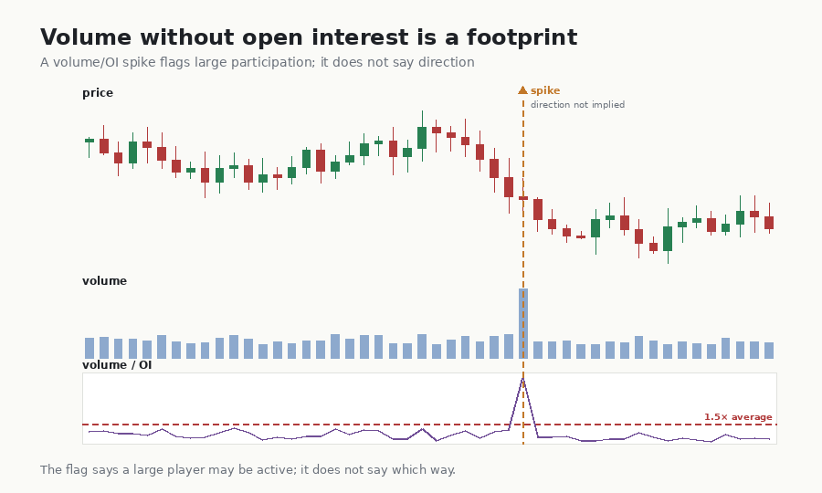

### Test

Compare high-volume/low-OI bars with high-volume/high-OI bars: forward returns at 1, 4, and 24 bars, subsequent volume, and OI change. Split by venue, symbol, and time of day.

### Observation

No clear result. One raw Pine v5 script flags `volume / OI` above 1.5× its 20-bar average on Binance USDT perpetuals. That ratio is a turnover proxy for large participation.

### Verdict

🔴 An interesting flag, no clear edge.

---

## 15

**Folder:** [`theories/15-launch-filters/`](theories/15-launch-filters/)

### Claim

Simple filters on early token activity can select tokens that multiply.

### Mechanism

Early transaction activity is a proxy for real demand and liquidity. If a token is going to multiply, its first minutes should show more organic trading than the average copycat launch. The filter is only useful if that difference survives a token-level baseline and trading costs.

### Test

The earlier dataset contains **8,420 discovery rows** but only **3,783 unique token addresses**; 2,118 unique tokens reached 1.5x. A token with several DEX pools was counted several times in the old report. Recompute one row per `baseToken.address` (highest-liquidity pool), then evaluate `txns_5m >= 0.25` on tokens rather than rows. Treat the discovery sample as adversarial: many tokens are copycats, and the dataset itself has selection bias.

### Result

After deduplication:

| Metric | Row level (old) | Token level (corrected) |
|---|---:|---:|
| Baseline | 56.77% | 55.99% |
| Filter win rate | 57.21% | 56.10% |
| Lift | +0.44 pp | **+0.11 pp** |
| Coverage | 75.99% | **99.71%** |

The filter selects almost the entire universe. The apparent lift was a duplicate-pool artifact. A first-row sensitivity check gives +0.09 pp; the latest-30% time split gives +0.05 pp.

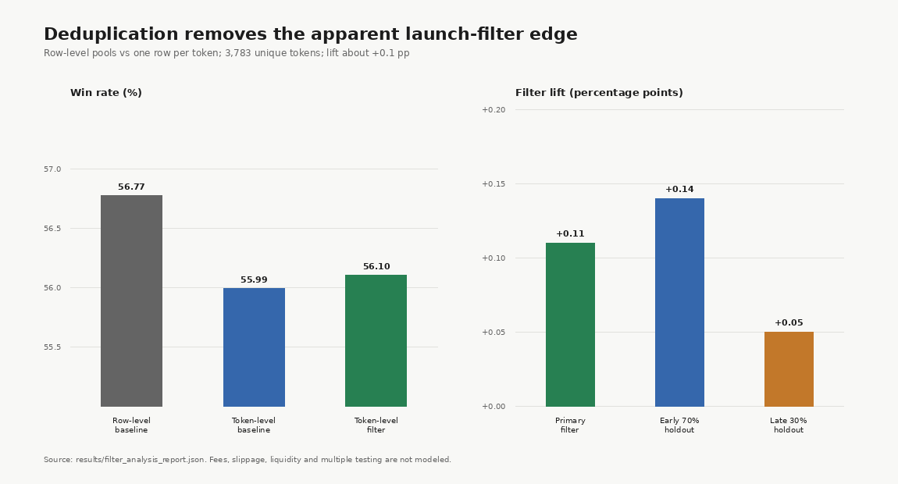

*Generated by `python3 scripts/render_result_charts.py` from `results/filter_analysis_report.json`. Fees and multiple testing are not modeled.*

### Verdict

🔴 The edge does not survive. The value here is the correction: the filter looked good only because tokens with several pools were counted several times. It does not survive a token-level baseline, let alone fees and slippage. In live use the filters were not consistent, and they were tuned too tightly to this dataset; that is confirmation bias, not a repeatable edge.

> [!NOTE]
> A later attempt replaced threshold search with three small neural models — win rate, high multiple, and retention — and derived filters from their predictions. It is kept in [`scripts/neural/`](theories/15-launch-filters/scripts/neural/); the numbers are in-sample, so treat them as optimistic.

---

## 16

**Folder:** [`theories/16-attention-index/`](theories/16-attention-index/)

### Claim

Google News volume, Google Trends, TikTok search attention, and crypto-related product sales capture retail engagement before it appears in price and flow.

### Mechanism

Retail attention usually precedes capital. Search, news, and short-video engagement capture curiosity before sign-ups and orders. Physical product sales are the slower, real-economy version: hardware wallets, mining hardware, and books are bought by people entering crypto, so they may show up before exchange volumes or sign-ups. A composite of those inputs could lead exchange activity and returns.

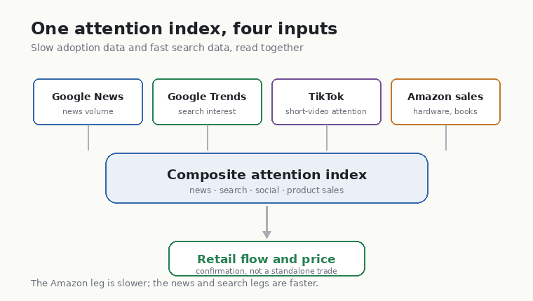

### Test

Build a composite attention index from search, news, social, and a fixed basket of crypto-related Amazon products; align it with on-chain activity, exchange volumes, and returns. Test lead-lag and whether the signal is incremental to price momentum.

### Observation

Useful as a confirmation indicator in practice. `data/sample/google-news.json` contains 241 raw Google News rows (238 usable daily observations, 2025-10-09 → 2026-08-18), and `data/sample/twitter-mention.json` contains a 130-token Twitter sample. The Google News count is a clean daily proxy for attention.

The Amazon adoption leg is a slower version of the same question: `scripts/legacy/amazonsell.js` parses an Amazon keyword search. `avgSoldPerListedProduct` divides total page-1 sales by the number of listed products, which makes it a per-listing sales rate.

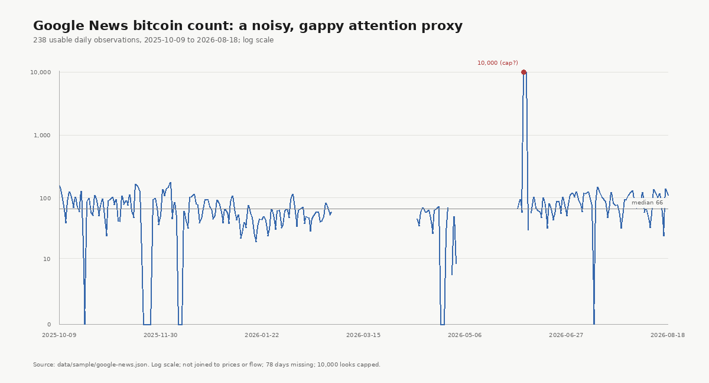

*Generated by `python3 scripts/render_result_charts.py` from `data/sample/google-news.json`. 238 usable observations; 78 missing days; 10,000 looks capped.*

### Verdict

🟢 A good confirmation indicator, not a standalone trade signal. The news, Twitter, and Amazon inputs are frozen and ready to combine.

---

## 17

**Folder:** [`theories/17-indicator-crowding/`](theories/17-indicator-crowding/)

### Claim

Indicators are not a timing signal; they are a measure of what most participants see. A raw score is not the same as what most users of that indicator will actually do.

### Mechanism

Widely watched indicators create common reference points. When RSI, Bollinger position, and moving averages all sit at an extreme, many participants see the same setup and place stops and orders around it. That clustering, not the indicator value itself, is the candidate signal.

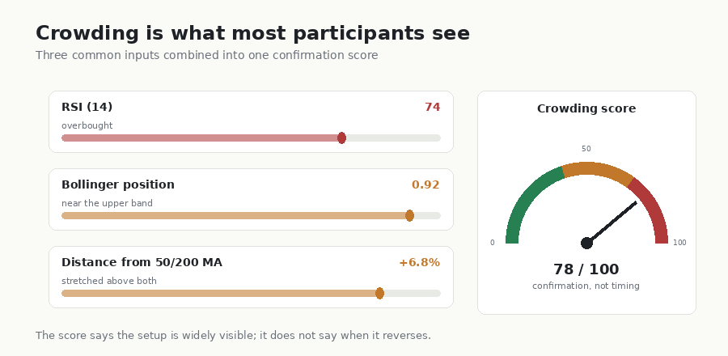

### Test

Build a cross-sectional crowding score from RSI, Bollinger position, and distance from moving averages. Test whether extremes predict reversal after costs, and whether the effect is stronger when the signal is widely watched.

### Observation

Useful as a confirmation indicator, in the same way as the attention index. Two collectors (`tradingview-indicators.js`, `tradingview-idea.js`) retrieve technical summaries and recent ideas. The first attempt found no significant result.

### Verdict

🟢 Keep it as a confirmation dashboard.

---

## 18

**Folder:** [`theories/18-weather-mood/`](theories/18-weather-mood/)

### Claim

The weather during a trader's session changes mood and same-day market behaviour: hot and cold days, heat and cold waves, and clear, cloudy, rainy, or stormy skies.

### Mechanism

Discomfort, sleep, alertness, and scheduling can shift risk appetite and desk staffing. Measure the local cash session, not daylight or generic seasonality, and separate it from holidays, the macro calendar, and ordinary risk co-movement.

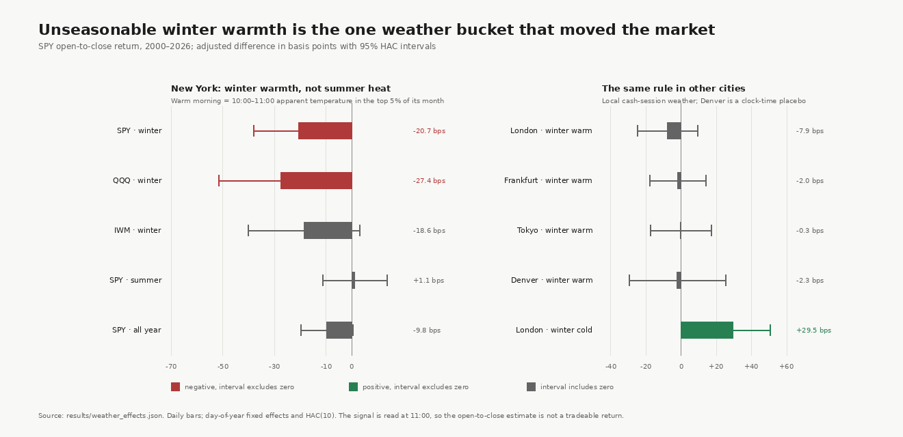

*Generated by `python3 scripts/render_result_charts.py` from `results/weather_effects.json`; 95% HAC intervals. The signal is read at 11:00, so the open-to-close estimate is not a tradeable return.*

### Test

Open-Meteo hourly reanalysis (1991–2026) and Yahoo Finance daily bars (2000–2026): 6,743 SPY days, 2,728 winter days. Weather is mean apparent temperature over the local cash session (New York, London, Frankfurt 10:00–15:00; Tokyo 10:00–14:00; Denver is a clock-time placebo). Hot or cold means the top or bottom 5% of the calendar month (`|z| > 1.645`); a wave is three or more consecutive days. Absolute thresholds, cloud, rain, and storm are tested too. Outcomes are open-to-close, close-to-close, range, absolute return, and relative volume, with time trend, lagged VIX and outcome, day-of-week dummies, day-of-year fixed effects, and HAC(10) errors. Rebuild with `collect_data.py`; the committed sample is `data/sample/weather_panel.csv`.

### Result

| Test (SPY unless noted) | Adjusted effect | t | p |
|---|---:|---:|---:|
| Winter warm morning → intraday | -21 bps | -2.34 | 0.019 |
| QQQ winter warm morning → intraday | -27 bps | -2.22 | 0.027 |
| Summer warm morning → intraday | +1 bps | 0.18 | 0.858 |
| Unseasonable heat wave → absolute return | -24 bps | -3.57 | 0.0004 |
| Rain → intraday | +1 bps | 0.28 | 0.780 |
| Clear → close-to-close | +6 bps | 1.67 | 0.096 |

The broad claim fails. Absolute heat and cold, 30°C+ waves, rain, cloud, and storm are flat on range, absolute return, and volume (all p > 0.3), and heat waves lower absolute returns rather than raise them. One cell survives: in November–March, an unseasonably warm New York morning (175 of 2,728 days) predicts a -21 bps SPY open-to-close return. QQQ replicates; IWM is weaker (p = 0.090); Denver, London, Frankfurt, and Tokyo do not. It survives both halves and cloud/precipitation controls, but warm mornings are cloudier and wetter, so it is not a sunshine proxy.

It is not tradeable. The signal is only complete at 11:00 while the outcome starts at 09:30, and about 6.5 signal days a year times 17 bps is roughly 1.1% gross before costs.

### Verdict

🟠 Context only. One small, New York-specific winter pattern survives; the broad weather-mood claim does not.

---

## Tools

Operational utilities live in the sibling repository `Trading-Support-Tools`.

### Week calendar
A trader utility that summarizes the week's macro and market events. It is not a theory and does not produce a signal.

### Charting
Shared chart-generation helpers for the theory reports.

### Execution and journal
`Trading-Support-Tools/betterGTrade/` contains the live execution journal and the reconciliation work. The bot's execution code is not part of this repository.

---

## Data and reproducibility

- **Sample data** is committed under `data/sample/` so a reader can run the code without API keys.
- **Raw data** is gitignored under `data/raw/`. Reproduce it with the scripts, or bring your own.
- **No proprietary redistribution.** Raw CME, Polymarket, and exchange data are not committed; only derived metrics and small samples are.

---

## Disclaimer

This is research and educational material. It is not financial advice, not a solicitation, and not a guarantee of future results. Markets involve risk, including total loss. Some datasets are noisy, incomplete, or survivorship-biased; the limitations are part of the result.
